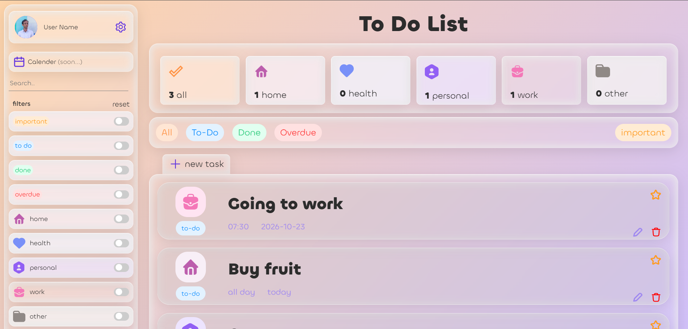

# Tick Task

A clean, category-based to-do list web app built with **HTML, CSS and pure JavaScript**, with no frameworks or libraries.

**[Live Demo](https://sadra00sa.github.io/Tick-Task/)**

<!-- Add a screenshot: save it as assets/screenshot.png and keep the line below -->


## Features

- **Add tasks** through a pop-up form with a title, description, category, status, time and date
- **Categories:** Home, Health, Personal, Work and Other, each with its own icon and task counter
- **Statuses:** To do, Done and Overdue
- **Important flag** to highlight high-priority tasks
- **Filters** for important, to do, done and overdue tasks, with a one-click reset
- **Weekly date strip** for browsing tasks by day
- **Delete confirmation dialog** to prevent accidental removals

## Built With

- HTML5
- CSS3 (custom styles, custom fonts, SVG and PNG icons)
- Vanilla JavaScript (ES6)

## Getting Started

No installation or build step is needed.

```bash
git clone https://github.com/sadra00sa/Tick-Task.git
cd Tick-Task
```

Then open `index.html` in your browser.

## Project Structure

```
Tick-Task/
├── assets/      # icons and images
├── fonts/       # custom fonts
├── style/       # CSS files
└── index.html   # main page
```

## Roadmap

- [ ] Calendar view (marked as "soon" in the app)
- [ ] Responsive layout improvements for small screens

## About

This is my first to-do list project, created while learning front-end development. It helped me practice DOM manipulation, event handling, form handling and building a UI layout from scratch.

## Author

**Sadra Salehi**
GitHub: [@sadra00sa](https://github.com/sadra00sa)
